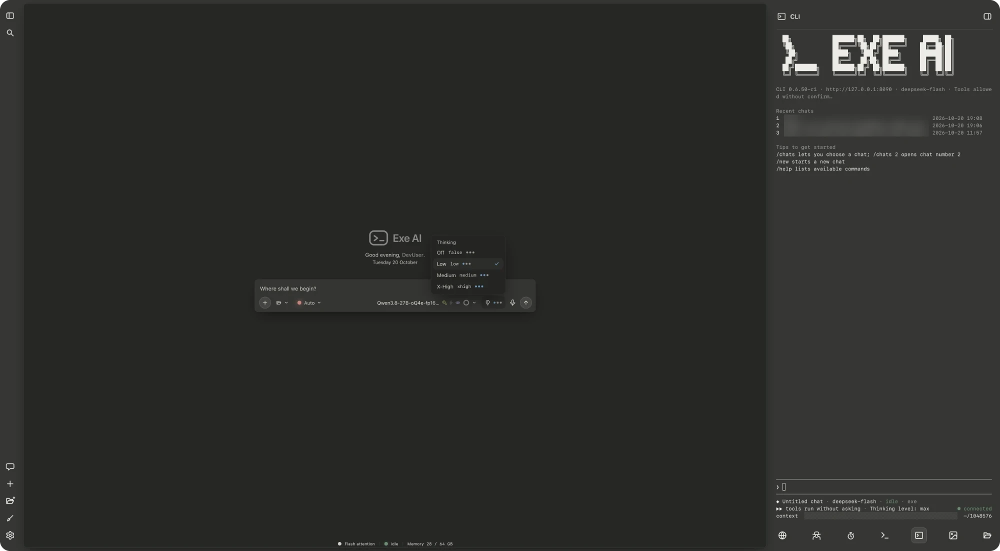
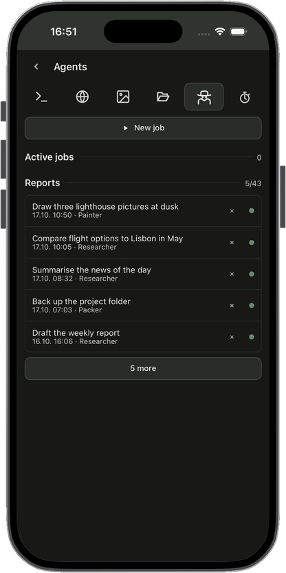
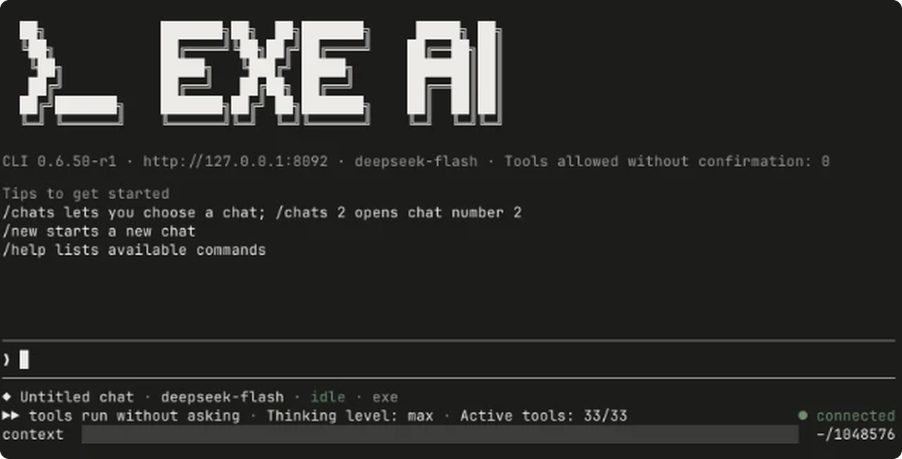
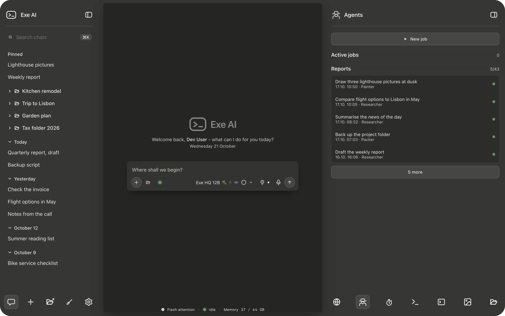
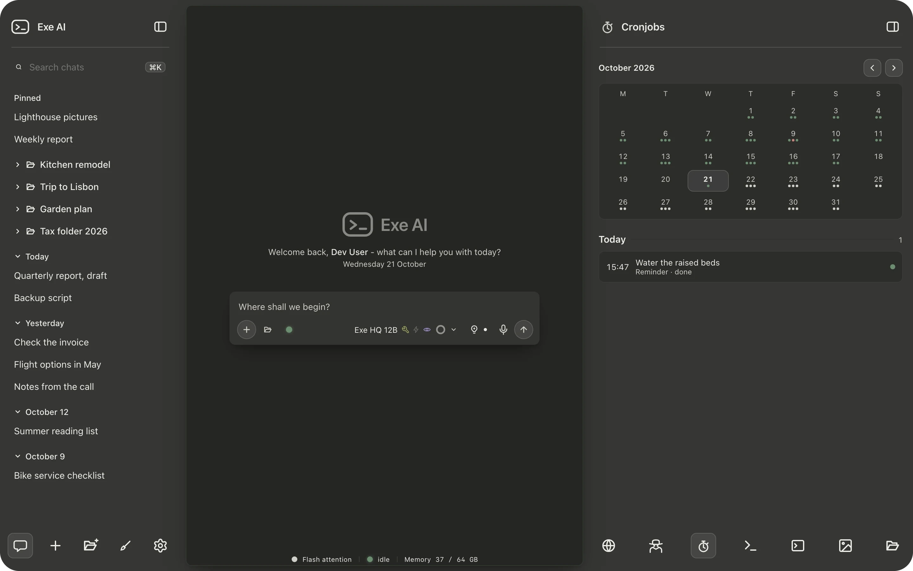
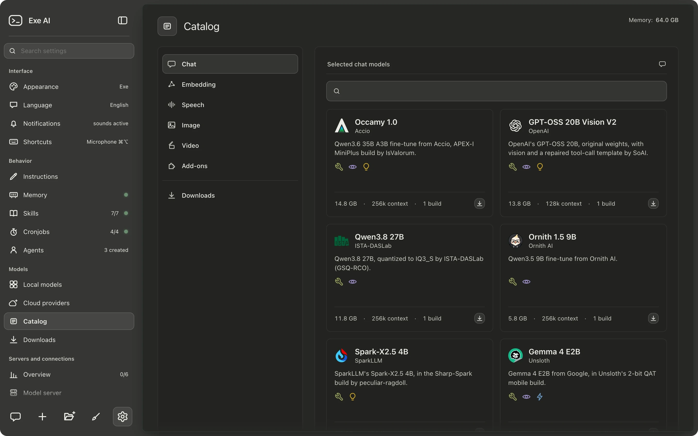
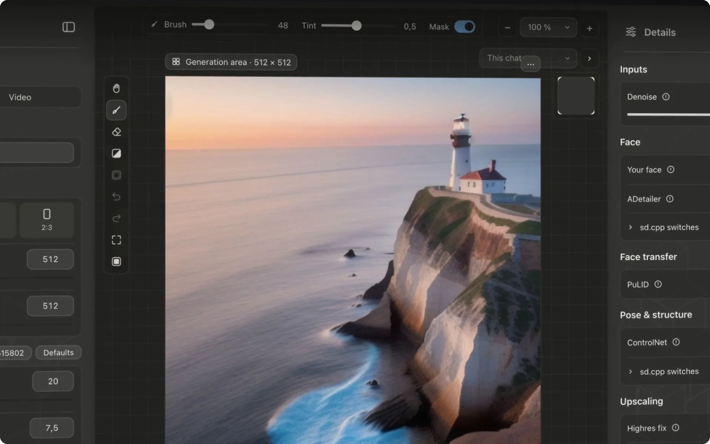

<p align="center">
  <a href="https://exe-hq.net">
  <picture>
    <source media="(prefers-color-scheme: dark)" srcset="docs/site/hero-dark.svg">
    <source media="(prefers-color-scheme: light)" srcset="docs/site/hero-light.svg">
    
  </picture>
  </a>
</p>

<p align="center"><b>Your models. Your machine.</b></p>

<p align="center">
  A local-first AI workspace for macOS and Windows. Chat with local or cloud models,<br>
  generate images and let agents work on a schedule, while your data stays on your own computer.
</p>

<p align="center">
  <a href="https://exe-hq.net"><picture><source media="(prefers-color-scheme: dark)" srcset="docs/site/download-macos-dark.svg"><source media="(prefers-color-scheme: light)" srcset="docs/site/download-macos-light.svg"></picture></a>
  &nbsp;
  <a href="https://exe-hq.net"><picture><source media="(prefers-color-scheme: dark)" srcset="docs/site/download-windows-dark.svg"><source media="(prefers-color-scheme: light)" srcset="docs/site/download-windows-light.svg"></picture></a>
</p>

<p align="center">
  <a href="https://exe-hq.net">Website</a>
  &nbsp;·&nbsp;
  <a href="https://exe-hq.net/help/">Help</a>
  &nbsp;·&nbsp;
  <a href="https://exe-hq.net/docs/">Docs</a>
</p>

<p align="center">
  <a href="https://github.com/exe-ai-productions/exe-ai/releases/latest"></a>
  
  
  <a href="LICENSE.md"></a>
</p>

<p align="center">
  
</p>

<p align="center">
  <a href="#at-a-glance">At a glance</a>
  &nbsp;·&nbsp;
  <a href="#features">Features</a>
  &nbsp;·&nbsp;
  <a href="#quick-start">Quick start</a>
  &nbsp;·&nbsp;
  <a href="#terminal-client">Terminal client</a>
  &nbsp;·&nbsp;
  <a href="#privacy">Privacy</a>
  &nbsp;·&nbsp;
  <a href="#help-and-community">Help and community</a>
  &nbsp;·&nbsp;
  <a href="#license">License</a>
</p>

## At a glance

- **Local models, end to end.** Download a model from a curated catalog or from Hugging Face and run it with the built-in `llama-server`. No shell, no scripts, no configuration files.
- **Cloud when you choose.** Connect Anthropic, OpenAI or an OpenAI-compatible endpoint with an API key.
- **Images and video, generated locally** with stable-diffusion.cpp.
- **Agents and schedules** that run from a chat or on their own.
- **Tools under your control**, including MCP servers, with three permission modes.
- **On your phone and in your terminal**, through the same local service as the app.

## Features

### Exe AI on your phone

On a phone or tablet, or in a window narrower than 600 pixels, Exe AI switches to a view designed for touch. Chat with attachments from the camera, your photos or your files, start and stop servers, search the catalog, track downloads, work in the Images area, and change settings and schedules. The phone view uses the Exe, Pearl or Snow design. [Set it up](https://exe-hq.net/docs/#docs/network) in a few steps and add it to your home screen.

<p align="center">
  
</p>

### Exe AI in the menu bar

When you close the window, Exe AI keeps running with an icon in the menu bar, or in the notification area on Windows. The icon shows whether the service is responding, and its menu opens the window, stops the service or quits the app. With the window closed, press Cmd+Shift+M (Ctrl+Shift+M on Windows) to open a new one and start dictating right away.

### A chat client for the terminal

The `exe` command brings your chats, models, servers, agents and schedules to the terminal and uses the same service as the app. A CLI tab in the right-hand column runs it inside the window. The terminal client is still in development; its [commands](https://exe-hq.net/docs/#cli/cli-commands) are on our website.

<p align="center">
  
</p>

### Agents, jobs and schedules

Define reusable agents in Markdown files with front matter. Run them from a chat or on a schedule, with progress updates and reports. Schedule agents, scripts or reminders, and see past runs and upcoming work in a calendar. For a one-off task, the assistant can hand the work to a helper that needs no agent file and report back in the conversation.

Unattended agents refuse actions that require approval. Agents started from a chat can send approval requests back to that conversation.

<p align="center">
  
  
</p>

### Tools and MCP

Use the built-in tools or connect MCP servers such as Notion, GitHub, Figma, Gmail, Recraft, Hugging Face or your own. A single sheet covers every way to connect: an API key in a header, a sign-in through the browser, or your own app, with its redirect URL ready to copy. Tool output, including content retrieved from web pages, is treated as data, not as instructions.

Share your working folders, or let a chat use a workspace of its own. Then choose how much the tools may do without asking:

- **Auto**: tools run without routine approval prompts, including access outside the working folders.
- **Manual**: file and command tools work within the working folders without asking. Access outside them and other tool calls generally require approval.
- **Restricted**: file and command operations within the working folders require approval as well.

How approvals, saved permissions and blocked commands work is described under [Permissions](https://exe-hq.net/docs/#docs/permissions).


### Local models

Browse a curated GGUF catalog matched to your computer's memory, or search Hugging Face. Every model in the catalog has been tested for startup, tool use and, where supported, image input. Its card shows the provider's original logo. Download a model with one click and run it with the built-in llama.cpp runner. Each server page shows its speed in tokens per second, and an overview lists every local server with its state, port, model and memory.

Already running a model server? Connections to **oMLX** and **LM Studio** have been tested. The speech catalog adds **Qwen3-ASR** and **Voxtral** for local speech recognition and **Qwen3-TTS** for speech output, with optional voice samples. Out of the box, Exe AI speaks with a voice of your system, and any voice model in GGUF format works as well.

<p align="center">
  
</p>

### Images and video

Create and edit images and generate video with compatible local models, powered by stable-diffusion.cpp. Adjust the generation settings, combine LoRAs, paint masks and keep your results in the gallery. The Images area keeps its own picture, mask and model, separate from your chats. The available workflows depend on the selected model, and video generation is still experimental. Video models have their own tab in the catalog.

<p align="center">
  
</p>

### Also in the app

- **Change course mid-answer.** Send a new message while an answer is being generated: the answer stops, keeps the text it has so far, and your message goes out at once. If a tool is running, Exe AI waits for its result first. When you stop an answer yourself, any queued messages return to the input field.
- **Chats side by side.** Several chats can answer at the same time.
- **Memory.** Keep rules and facts for future conversations in an editable local memory file. Memory is on by default for the models Exe AI runs itself, and it is shared with other servers and cloud models only if you enable that option.
- **Dictation.** Dictate into the chat and watch a provisional transcript appear as you speak. Optional clean-up uses a small dedicated model or a model of your choice. Send the result yourself, or have it sent automatically when dictation ends. Press Cmd+Shift+M (Ctrl+Shift+M on Windows) to start dictating while another app is in front.
- **Voice conversations.** Talk to the assistant with automatic pause detection and, with speech output enabled, hear each reply sentence by sentence as it is generated. Speech recognition and speech output run locally; the conversation itself uses your chosen chat model.
- **Projects and files.** Group chats into projects that share working folders, and archive chats or whole projects when you are done. Uploaded documents and files delivered by agents are collected in one place.
- **Skills.** Run a skill with a slash command, let the assistant pick eligible skills automatically, or write and edit your own in the app.
- **Live work view.** Follow command output and tool activity beside the chat. Preview every kind of file without leaving the conversation: code with line numbers, text, pictures, SVG, video and audio, PDF pages, and Word, Excel and PowerPoint files.
- **Notification sounds.** Four soft sounds tell you that an answer has finished, that Exe AI is waiting for you, that an error has occurred, or that an agent or schedule has finished. Each has its own switch for sound and pop-up, and the background service follows the same switches.
- **Documents with clear limits.** Attach PDFs, text files or source files. A document that fits the available context budget is included in full; a larger one stays available for targeted reading through tools, and the interface tells you when it is too large for the context.
- **Context compression** (in development). Older tool output is reduced first; if that is not enough, the middle of the conversation is summarized while the opening and the most recent messages are kept. The original chat remains readable.
- **Six designs.** Exe, Snow, Pearl, Dark Matter, Heaven and Moune restyle the entire interface, from the frame to the code blocks; Auto shows Exe when your system is dark and Snow when it is light. You can also choose one of nine code color schemes and set your own bubble color and frame gradient. [More about designs](https://exe-hq.net/docs/#docs/themes)
- **Personal, in two languages.** Enter your name on first launch and new chats greet you by name; a single switch turns this off. The interface and its error messages are available in English and German.
- **Updates itself.** At startup, the app checks for a newer release, shows what is new and installs it with one click.

## Quick start

### System requirements

- **macOS** on Apple Silicon.
- **Windows** on x64.
- **Local models** need enough memory. The catalog shows which models fit your computer.
- **Phone or tablet**: a current browser, with Tailscale on the phone and on the computer.

### Download the app

Download the app for your operating system from [exe-hq.net](https://exe-hq.net) or from the [latest release](https://github.com/exe-ai-productions/exe-ai/releases/latest). No account is needed.

- **macOS (Apple Silicon)**: open the `.dmg` and drag the app into your Applications folder. The app is signed and notarized by Apple.
- **Windows (x64)**: run the installer. It is not code-signed yet, so Windows SmartScreen may show "Windows protected your PC". Choose *More info*, then *Run anyway*.

Closing the window does not end Exe AI: it stays in the menu bar, and the service keeps running for the terminal client. *Quit Exe AI* in the icon's menu closes the app but leaves the service running; *Stop Service* ends the service and its model server.

To use Exe AI on your phone, follow [Web App & network](https://exe-hq.net/docs/#docs/network). For a first tour of the app, see [Getting started](https://exe-hq.net/help/#erste-schritte).


<details>
<summary><b>Run from source</b></summary>

<br>

You need Python 3.11 or 3.12 and Node.js 22.

```bash
git clone https://github.com/exe-ai-productions/exe-ai
cd exe-ai
python3 -m venv .venv
.venv/bin/pip install -r requirements.txt
cd frontend && npm ci && npm run build && cd ..
.venv/bin/uvicorn app.main:app --host 127.0.0.1 --port 8090
```

Then open `http://127.0.0.1:8090/app/` in your browser. If the Exe AI app is running, first choose *Stop Service* from its menu bar icon: the app uses the same port, and its service keeps running after the window closes.

Start the terminal client from source with `.venv/bin/python start.py --cli`. To run local models, install [llama.cpp](https://github.com/ggml-org/llama.cpp) or let the Local view download `llama-server`, as the packaged app does. Run the test suite with `.venv/bin/pytest`.

</details>

## Terminal client

The `exe` command is a chat client for the terminal and is still in development. Its [introduction](https://exe-hq.net/docs/#cli/cli-intro), [slash commands](https://exe-hq.net/docs/#cli/cli-commands), [print mode](https://exe-hq.net/docs/#cli/cli-print) and [settings and themes](https://exe-hq.net/docs/#cli/cli-settings) are documented on our website.

## Privacy

- By default, the service listens only on **127.0.0.1**. Chats, settings, keys and models are stored locally, in files and a SQLite database.
- The Web App reaches your computer only through your own Tailscale network, over HTTPS, and every request that comes that way must carry the password.
- API keys are stored in a local file with restricted permissions and are never displayed again. The interface only learns *whether* a key has been set.
- Saved memories are shared with cloud providers only if you enable that option. While name-based personalization is on, your name is sent with each conversation, including to cloud providers.
- Models are downloaded directly from huggingface.co. Model searches go through the local service, so your browser does not contact Hugging Face for them.
- The model server receives a new key each time it starts. The app also protects its API with a key generated for each session and rejects cross-origin write requests from web pages.

<!-- Working title and address of the developer page are placeholders until they are decided. -->
The local HTTP API that the app uses is documented on the [API documentation](https://exe-hq.net/docs/) page.

## Help and community

- **Questions and ideas**: ask in [Discussions](https://github.com/exe-ai-productions/exe-ai/discussions).
- **Bugs**: open an [issue](https://github.com/exe-ai-productions/exe-ai/issues) with your version of Exe AI and the steps that lead to the problem.
- **Something not working?** Start with [Troubleshooting](https://exe-hq.net/help/#hakt) in the manual.
- **Everything else**: write to [dev@exe-hq.net](mailto:dev@exe-hq.net).

## License

Exe AI is released under the [PolyForm Noncommercial License 1.0.0](LICENSE.md). In plain terms: you may use, modify and share it for personal, educational or other noncommercial purposes. Commercial use, such as use within a company or for paid work, requires a commercial license. Contact [dev@exe-hq.net](mailto:dev@exe-hq.net).

<br>

<p align="center">
  
</p>
<p align="center">
  <a href="https://exe-hq.net">exe-hq.net</a>
  &nbsp;·&nbsp;
  <a href="https://github.com/exe-ai-productions/exe-ai/releases">Releases</a>
  &nbsp;·&nbsp;
  <a href="PATCHNOTES.md">Patch notes</a>
  &nbsp;·&nbsp;
  <a href="https://github.com/exe-ai-productions/exe-ai/issues">Issues</a>
  &nbsp;·&nbsp;
  <a href="https://github.com/exe-ai-productions/exe-ai/discussions">Discussions</a>
  &nbsp;·&nbsp;
  <a href="THIRD_PARTY_NOTICES.md">Third-party notices</a>
</p>
<p align="center"><sub>© 2026 Exe AI Productions</sub></p>
